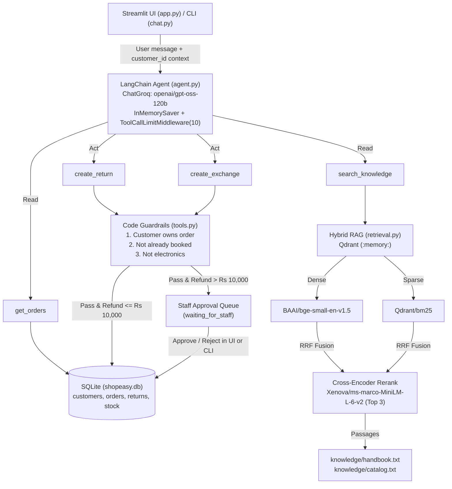

# ShopEasy Returns Agent

AI customer-support agent for handling product returns and size exchanges for a fictional Indian e-commerce store. Built with LangChain, Groq, Qdrant + FastEmbed, SQLite, and Streamlit.

## System Design



### Core Components

| Component | File | Responsibility |
| :--- | :--- | :--- |
| **Agent** | `agent.py` | Configures `ChatGroq` (`openai/gpt-oss-120b`), attaches the 4 tools, injects today's date into the system prompt, maintains per-thread memory via `InMemorySaver`, and caps tool loops at 10 calls via `ToolCallLimitMiddleware`. |
| **Prompts** | `prompts.py` | Stores versioned system prompts (`v1`–`v5`, currently `v5`), documenting what failure mode each iteration addressed. |
| **Tools & Guardrails** | `tools.py` | Exposes `get_orders`, `search_knowledge`, `create_return`, and `create_exchange`. Reads `customer_id` from `runtime.context` (out-of-band from the LLM) and enforces deterministic business rules in `guardrails()` before any database write. |
| **Hybrid RAG** | `retrieval.py` | Splits `knowledge/handbook.txt` and `knowledge/catalog.txt` into paragraphs and indexes them in an in-memory Qdrant collection with both dense (`BAAI/bge-small-en-v1.5`) and sparse (`Qdrant/bm25`) vectors. Queries merge top-10 dense and top-10 BM25 hits via Reciprocal Rank Fusion (RRF), then rerank with `Xenova/ms-marco-MiniLM-L-6-v2` to return the top 3 passages. |
| **Database** | `database.py` | SQLite wrapper (`shopeasy.db`) with 4 tables: `customers`, `orders`, `returns`, and `stock`. `reset()` seeds 6 customers (`C-101`–`C-106`), 17 orders, and size-exchange inventory. |
| **Interfaces** | `app.py`, `chat.py` | Streamlit web UI and terminal CLI. Both stream intermediate reasoning, tool calls, and tool results (`stream_mode="updates"`), and provide a staff approval queue for high-value refunds. |
| **Evaluations** | `evals.py`, `golden_dataset.csv` | Runs multi-turn test cases across prompt versions against a fresh `database.reset()` per run, scoring final DB state, required/forbidden tool calls, and reply constraints. |

### Guardrails & Human-in-the-Loop

Before `create_return` or `create_exchange` writes to SQLite, `guardrails()` in `tools.py` enforces three hard checks:
1. **Ownership:** The `order_id` belongs to the logged-in `customer_id`.
2. **Idempotency:** No return or exchange is already booked for that `order_id`.
3. **Category limit:** Electronics (`category == "electronics"`) cannot be returned for a refund.

Additional action checks:
- **Returns > ₹10,000** (`STAFF_APPROVAL_ABOVE = 10_000`) are saved with `status = "waiting_for_staff"` and require manual approval or rejection from the Streamlit sidebar or CLI `staff` command.
- **Exchanges** require a non-null `size` (clothing/footwear) and available `stock`, decrementing inventory upon booking.

## Running Locally

```zsh
sh setup.sh
.venv/bin/python database.py
.venv/bin/streamlit run app.py
```

Or run in the terminal:
```zsh
.venv/bin/python chat.py
```

Run prompt evaluations:
```zsh
.venv/bin/python evals.py
```
